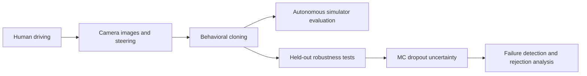
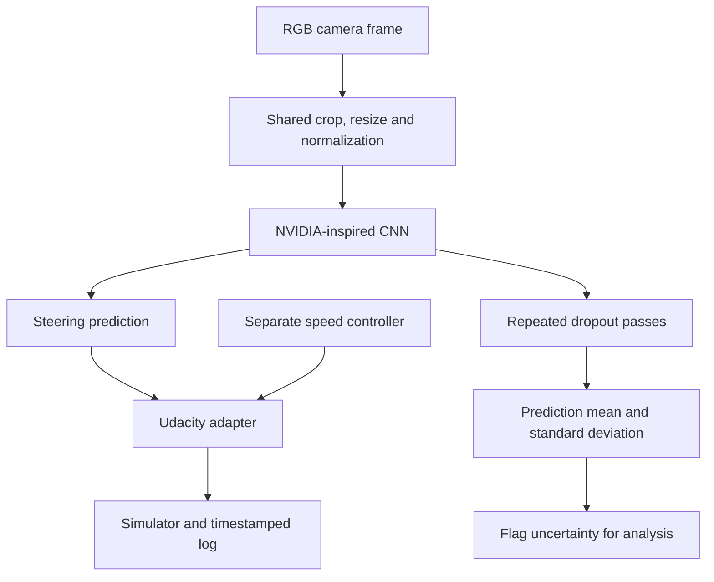
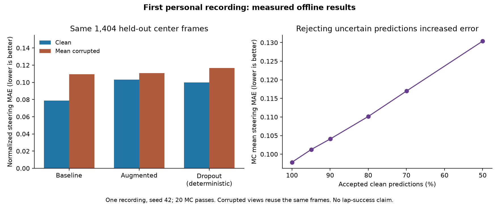

# RobustDrive

### Failure Detection and Uncertainty in End-to-End Autonomous Driving

[](https://github.com/ericqin0816/RobustDrive/actions/workflows/tests.yml)
[](https://www.python.org/)
[](https://pytorch.org/)
[](LICENSE)

RobustDrive trains an end-to-end vision model to steer a simulated vehicle from
camera images, then studies its errors under visual distribution shift and whether
uncertainty can flag unreliable steering predictions.

**Research status: first personal recording evaluated.** Three models were trained
on 9,459 usable simulator rows. The center-only baseline performed best among
these models; MC dropout did not reliably identify high-error predictions.
Live simulator control works, but annotated lap success remains unmeasured.
See [measured results](reports/research_report.md) and [software verification](reports/verification.md).

**Windows shortcut:** [Play & Learn](docs/play.md) lets you record a drive, stop
recording, and close the game to start training and analysis automatically.

## 1. Overview

A person drives, the simulator records images and steering, a compact PyTorch CNN
learns from those examples, and its predictions steer the simulator. Every model
starts from random weights. Version 1 includes data validation, training/resume,
a Udacity adapter, drive logging, controlled corruptions, MC dropout, selective
prediction, and experiment comparison. This is a simulator research project.

## 2. Research question

**When does a behavioral-cloning steering model fail, and can its uncertainty
identify unreliable predictions before the vehicle leaves the road?**

The first measurable subquestion uses high steering error as an **offline proxy**.
It does not establish early warning of a collision or road departure. That stronger
claim needs real simulator event logs, a lead-time definition, and prospective
closed-loop testing.

## 3. Demo

> Autonomous-driving demo coming after real simulator evaluation.

Add a real recording here after evaluation. Include the checkpoint, track, speed,
takeovers, and associated drive log. Do not substitute procedural smoke images
for an autonomous-driving demonstration.

## 4. How it works



## 5. Architecture



Five convolutions use channels 24, 36, 48, 64, 64; the first three use 5×5
kernels/stride 2, the last two 3×3/stride 1. Dense layers are 100 → 50 → 10 → 1,
with ReLU activations and configurable dropout. The model has **252,219 trainable
parameters**, counted by the implementation. The output is normalized steering,
not degrees. Predictions are unclipped offline and clipped to [-1, 1] only when
sent to the simulator.

## 6. Dataset collection

Follow [the collection guide](docs/data_collection.md) and
[simulator setup](docs/simulator.md). Put your recordings here:

```text
data/raw/
├── driving_log.csv
└── IMG/
    ├── center_....jpg
    ├── left_....jpg
    └── right_....jpg
```

The loader accepts header/headerless `center,left,right,steering,throttle,brake,speed`
logs, moved Windows/POSIX paths, and optional telemetry columns. Missing/corrupt
images and invalid steering labels are reported and excluded. Set
`data.invalid_policy: error` to stop on defects. Later image-read errors fail
explicitly rather than substituting fake pixels.

## 7. Behavioral cloning

One shared `Preprocessor` handles training, evaluation, and driving:
RGB uint8 → crop 50 top/20 bottom pixels → resize to 66×200 → CHW tensor →
normalize to [-1, 1]. The checkpoint preserves the exact configuration.

The default split is **chronological 70/15/15 with 30 frames discarded at each
boundary**. Split rows before expanding cameras. Random frame-level splits can
leak nearly identical neighboring images and overstate generalization. Actual
retained counts differ from the requested ratios. Save source row IDs, split
indices, and a data fingerprint. Repeated laps may still share similar views;
this is not a guarantee of generalization to new tracks.

## 8. Data augmentation

The baseline uses center images and no augmentation. The augmented configuration
adds side cameras, flips, brightness/contrast, shadows, small translations,
Gaussian noise, and mild blur. Each transform is independently configurable.
Optional tiny camera roll is disabled by default. Validation/test use center
images with deterministic preprocessing only.

**Sign convention:** Udacity's positive steering turns right. Left-camera
recovery uses `steering + correction`, right-camera recovery uses
`steering - correction`, and flipping negates the corrected label. The default
0.2 correction is a tunable heuristic, not a physical calibration. Sources and
a manual sign check are in [the collection guide](docs/data_collection.md).

## 9. Training

```bash
python scripts/train.py --config configs/baseline.yaml
python scripts/train.py --config configs/augmented.yaml
python scripts/train.py --config configs/uncertainty.yaml
```

MSE loss, AdamW, validation-based learning-rate reduction, early stopping,
reproducible seeds, automatic GPU selection, and CPU fallback are implemented.
Each run saves `config.yaml`, `metadata.json`, `inspection.json`, `splits.json`,
`history.csv`, `metrics.json`, `best.pt`, and `latest.pt`. Metadata includes
software versions, device, parameter count, provenance, training time, and Git state.

```bash
python scripts/train.py --config configs/baseline.yaml --resume experiments/results/baseline/latest.pt --epochs 45
python scripts/train.py --config configs/baseline.yaml --name baseline_v2
```

Resume retains the original run and accepts an increased epoch limit. New
experiments need new names. Epoch-wise seeding reproduces CPU resume in tests;
hardware/library changes may still differ. Run commands from the repository root.
Data paths are relative to that directory; YAML `extends` paths are relative to
the configuration file.

## 10. Autonomous driving

After real-data training, start the adapter, then select Autonomous Mode:

```bash
python scripts/drive.py --checkpoint experiments/results/baseline/best.pt --output experiments/results/drive_baseline_01 --target-speed 12 --record-frames
```

In a second terminal, mark only events that actually occur:

```bash
python scripts/mark_event.py lap_start
python scripts/mark_event.py takeover --note "approaching left edge"
python scripts/mark_event.py off_track
python scripts/mark_event.py resume
python scripts/mark_event.py lap_complete
python scripts/evaluate_drive.py --log-dir experiments/results/drive_baseline_01
```

Also available: `collision` and `lap_abort`. `takeover` pauses network steering
responses; use the simulator's controls to physically take over, then `resume`.
The annotation command does not press controls or apply brakes.

The Windows launcher exposes 12/15/20/25/30 mph targets before **Watch my model**.
Speed is controlled separately from learned steering. The proportional controller
can settle below its target (the first 12 mph trial settled near 10.85 mph).
Saved camera images default to at most 5 fps and 10,000 images per run; telemetry
continues for every response. Override with `--record-fps` and `--max-recorded-frames`.

Logs include prediction, commanded steering, speed, throttle, uncertainty, risk
flags, frame IDs, and inference latency. Metrics include annotated lap completion,
unassisted laps, interventions, time between interventions, failures, lap time,
mean absolute steering change, and RMS steering rate. The penalty score is
`100 × max(0, 1 − takeovers × penalty_seconds / duration_seconds)`; separately,
time autonomy uses takeover/resume durations. Events are human annotations.

The adapter listens on `127.0.0.1:4567`. Unity handshake and steering were observed
in the first live trial. Lap completion still needs annotation; a log with no
events receives no autonomy score. See [the simulator guide](docs/simulator.md).

## 11. Robustness benchmark

```bash
python scripts/benchmark_robustness.py --checkpoint experiments/results/baseline/best.pt
```

Eleven corruptions at severity 0–5: darkening, brightening, contrast reduction,
Gaussian blur, motion blur, noise, occlusion, horizontal/vertical shifts, shadows,
and color shift. Severity 0 is exactly clean. Each condition reports MAE, RMSE,
and changes from clean. The optional aggregate is the unweighted mean MAE over
selected nonzero corruption/severity pairs; lower is better. Compare aggregates
only for matching conditions/data. Equations are in [the protocol](docs/experimental_protocol.md).
Image shifts retain labels as camera perturbations; they are not new physical
trajectories with verified steering labels.

## 12. Uncertainty estimation

```bash
python scripts/evaluate_uncertainty.py --checkpoint experiments/results/uncertainty/best.pt
```

Twenty stochastic passes enable dropout only. Outputs include mean steering,
sample standard deviation/variance, and Pearson/Spearman correlation with error.
Zero-dropout checkpoints are rejected. The default analyzes clean images plus
darkening, blur, noise, and shadow. Use `--corruptions` to select other conditions.
Per-frame predictions and corruption seeds are saved.

## 13. Failure detection

Predeclare a high-error definition: `abs(prediction − steering) > 0.15` by default.
It is an offline proxy, **not a calibrated danger boundary**. The cutoff is the
90th percentile of clean validation uncertainty, frozen before test evaluation.
Metrics include precision, recall, F1, ROC-AUC, trapezoidal PR-AUC, and average
precision. Undefined single-class AUCs/correlations are `null`.

Selective prediction accepts the lowest-uncertainty 100%, 95%, 90%, 80%, 70%, or
50% of test predictions and reports actual coverage, MAE, and RMSE. This is an
offline ranking analysis, not an automatic takeover policy.

```bash
python scripts/drive.py --checkpoint experiments/results/uncertainty/best.pt --output experiments/results/drive_uncertainty_01 --mc-samples 20 --uncertainty-report experiments/results/uncertainty/uncertainty.json
```

Online risk flags are observational; they do not guarantee safety. MC latency
must be checked before interpreting closed-loop results.

## 14. Experiments

| Stage | Experiment | Research status |
|---|---|---|
| A | Center-camera behavioral cloning | First recording complete |
| B | Recovery cameras and augmentation | First recording complete |
| C | Autonomous simulator laps | Live control verified; annotated laps pending |
| D | Visual robustness | 11 corruptions × 5 nonzero severities evaluated |
| E | MC dropout uncertainty | 20-pass analysis complete |
| F | Error detection and rejection | Negative result on first recording |
| G | Ablation and failure analysis | Three variants reviewed; component ablations pending |

```bash
python scripts/run_ablation.py
python scripts/run_ablation.py --train
python scripts/make_figures.py
```

Without `--train`, aggregate existing measurements only. With it, train/reuse
A baseline, B +flips, C +recovery, D +visual augmentation, E +dropout and perform
clean evaluation. Run robustness/uncertainty commands for each applicable
checkpoint before aggregating those columns. Real and synthetic tables are
separate. See [experiment outputs](experiments/README.md).

## 15. Results

One personal recording, seed 42, shared chronological split, 1,404 held-out center
frames. Errors are normalized steering units. These are offline measurements.

| Model | Clean MAE | Clean RMSE | Mean corrupted MAE |
|---|---:|---:|---:|
| Center-only baseline | 0.07891 | 0.12519 | 0.10934 |
| Recovery + visual augmentation | 0.10306 | 0.14813 | 0.11065 |
| Augmentation + dropout, deterministic | 0.10000 | 0.14616 | 0.11675 |

Clean MC-dropout high-error detection had ROC-AUC **0.2837**, precision **6.74%**,
and recall **4.80%** at the validation-derived threshold. Rejecting the most
uncertain half **increased** MAE from 0.09783 to 0.13040. This is not a validated
failure warning. An exploratory always-zero steering reference achieved lower
MAE (0.05502) but worse RMSE (0.14903) than the learned baseline, illustrating
the strongly imbalanced labels and why MAE alone does not establish useful driving.



[Research report](reports/research_report.md) ·
[Frozen numerical evidence and hashes](reports/results/first_recording/manifest.json).
No annotated lap-completion or early-warning result is claimed.

Generated CSV/Markdown tables live in `reports/tables/`; labeled PNG and vector
PDF figures live in `reports/figures/<run>/`. Data, checkpoints, and generated
outputs are excluded from Git. A small, reviewed aggregate snapshot is published
under `reports/results/first_recording/`; camera data and checkpoints remain local.

## 16. Failure cases

Export image grids for highest error, highest uncertainty, high error/high
uncertainty, low error/high uncertainty, and **confidently wrong** predictions.
Panels show target, prediction, error, uncertainty, corruption, and severity.
Empty categories produce empty CSVs, not invented examples.

## 17. Installation

Python 3.11+; CI covers 3.11 on Linux and 3.12 on Windows. No paid services or
cloud GPU are required. On Windows:

```powershell
git clone https://github.com/ericqin0816/RobustDrive.git
cd RobustDrive
py -3.12 -m venv .venv
.\.venv\Scripts\python.exe -m pip install --upgrade pip
.\.venv\Scripts\python.exe -m pip install -e ".[dev]"
```

Use `.\.venv\Scripts\Activate.ps1` to activate, or replace every `python` below
with `.\.venv\Scripts\python.exe` if PowerShell blocks activation. No policy change
is needed. On macOS/Linux: `python3 -m venv .venv`, `source .venv/bin/activate`,
then `python -m pip install -e '.[dev]'`. For an NVIDIA GPU, install an appropriate
wheel from [PyTorch's official selector](https://pytorch.org/get-started/locally/).
CPU is sufficient for smoke validation.

## 18. Usage

```bash
python -m pytest -q
python -m ruff check src scripts tests
python scripts/check_cli.py
python scripts/create_sample_data.py
python scripts/train.py --config configs/smoke.yaml
python scripts/evaluate.py --checkpoint experiments/results/smoke/best.pt
# Full synthetic verification, reusing existing matching smoke runs:
python scripts/smoke.py --ablation
```

The generator refuses to overwrite an existing CSV. Every major CLI supports
`--help`. Optional Make targets: `install`, `test`, `lint`, `smoke`,
`train-baseline`, `train-augmented`, and `figures`.

## 19. Repository structure

```text
RobustDrive/
├── configs/                 baseline, augmented, uncertainty, smoke
├── data/                    notes and ignored recordings/sample output
├── docs/                    simulator, collection, experiment protocol
├── src/robustdrive/
│   ├── data/                loading, splits, preprocessing, augmentation
│   ├── models/              steering CNN and MC dropout
│   ├── training/            optimizer, scheduling, checkpoints, resume
│   ├── evaluation/          metrics, robustness, uncertainty, figures, ablations
│   ├── simulator/           policy interface, Udacity adapter, speed controller
│   └── utils/               seeds, paths, serialization
├── scripts/                 command-line entry points
├── experiments/             guide and ignored run outputs
├── reports/                 portfolio drafts, research report, verification
│   ├── figures/             generated PNG/PDF figures
│   └── tables/              generated CSV/Markdown comparisons
├── notebooks/               exploratory analysis
├── tests/                   unit and synthetic integration tests
└── .github/workflows/       Linux/Windows CPU CI
```

## 20. Limitations

- One personal recording and an unannotated live trial; no verified lap-success rate.
- Offline steering error cannot establish closed-loop stability or early warning.
- MC dropout may be confidently wrong; uncertainty is uncalibrated.
- Camera corrections and translated-image labels are approximate.
- Chronological splits may differ in route coverage; repeated laps can share views.
- Corrupted variants reuse images and are not independent observations.
- The old simulator requires local compatibility testing. The adapter supports
  only its text WebSocket subset, not general Socket.IO/polling.
- Human annotations have reaction delay; no automatic lane/collision truth or
  fractional lap-distance measurement is available.
- One seed is a starting point, not evidence of statistical significance.

## 21. Future work

After real evaluation: CNN-LSTM temporal steering, DAgger, reinforcement learning,
deep ensembles, calibration, optical flow, segmentation, Vision Transformers,
CARLA, Donkey Car deployment, and sim-to-real transfer. None is implemented in V1.

## 22. References

- Bojarski et al., [End to End Learning for Self-Driving Cars](https://arxiv.org/abs/1604.07316), 2016.
- Udacity, [Behavioral Cloning project](https://github.com/udacity/CarND-Behavioral-Cloning-P3).
- Udacity, [Self-Driving Car Simulator](https://github.com/udacity/self-driving-car-sim).
- Gal & Ghahramani, [Dropout as a Bayesian Approximation](https://arxiv.org/abs/1506.02142), 2016.
- [PyTorch documentation](https://docs.pytorch.org/docs/stable/index.html).

Behavioral cloning, the architectural inspiration, and MC dropout come from prior
work. RobustDrive contributes an independent modern implementation and an auditable
framework for personal experiments. The first-session results above are a limited
empirical evaluation, not a claim of a new method or general driving reliability.

Portfolio drafts: [website summary](reports/project_summary.md) ·
[resume templates](reports/resume_bullets.md) · [research report](reports/research_report.md).
